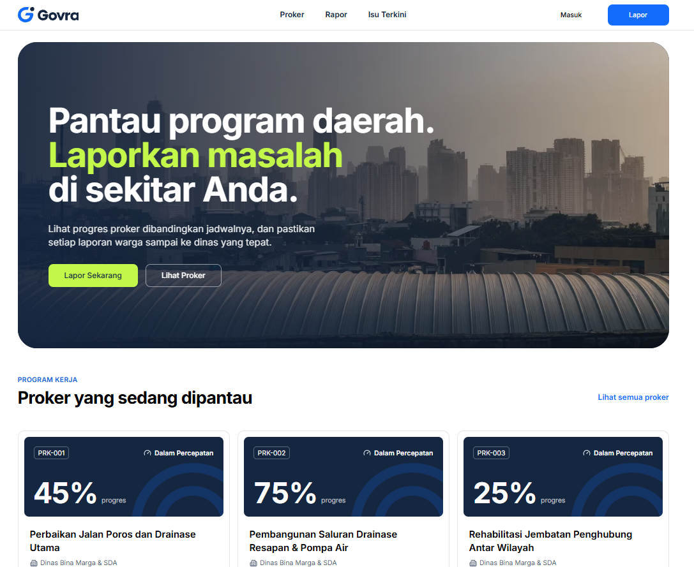
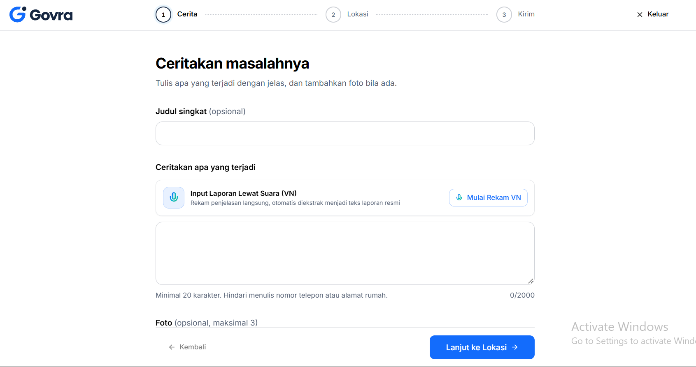
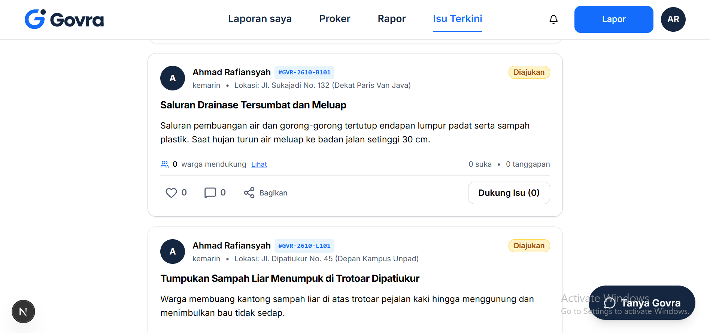
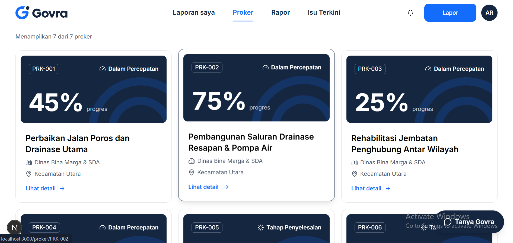

<div align="center">
  
  <p><strong>Platform Transparansi Program Kerja & Pelaporan Warga Cerdas Berbasis AI</strong></p>

  [](https://golang.org)
  [](https://nextjs.org)
  [](https://react.dev)
  [](https://tailwindcss.com)
  [](https://supabase.com)
  [](https://deepmind.google/technologies/gemini/)
</div>

---

## 📌 Daftar Isi

1. [Tentang Govra](#-tentang-govra)
2. [Latar Belakang & Masalah](#-latar-belakang--masalah)
3. [Tangkapan Layar & Antarmuka (Preview)](#-tangkapan-layar--antarmuka-preview)
4. [Peran Pengguna (User Roles)](#-peran-pengguna-user-roles)
5. [Fitur Unggulan](#-fitur-unggulan)
6. [Arsitektur Sistem & Keamanan](#-arsitektur-sistem--keamanan)
7. [Tumpukan Teknologi (Tech Stack)](#-tumpukan-teknologi-tech-stack)
8. [Panduan Instalasi & Menjalankan](#-panduan-instalasi--menjalankan)
9. [Akun Demo & Uji Coba](#-akun-demo--uji-coba)
10. [Struktur Repositori](#-struktur-repositori)
11. [Lisensi & Kontribusi](#-lisensi--kontribusi)

---

## 🏛️ Tentang Govra

**Govra** adalah platform tata kelola kota digital modern yang menjembatani komunikasi dua arah antara **warga masyarakat** dan **pemerintah daerah (OPD/Dinas & Admin Pusat/Wali Kota)** secara transparan, partisipatif, dan akuntabel.

Menggunakan kecerdasan buatan (*Google Gemini 2.5 Flash*), Govra mengotomatiskan pengelompokan laporan, deteksi isu ganda (*duplicate detection*), pengaburan data pribadi (*PII redaction*), serta perutean aduan langsung ke dinas berwenang tanpa memaksa warga menghafal struktur birokrasi pemerintahan. Di saat yang sama, seluruh progres program kerja (RPJMD/RKPD) dan realisasi anggarannya dipublikasikan secara terbuka dengan bukti dokumentasi lapangan yang dapat diawasi bersama.

---

## 💡 Latar Belakang & Masalah

| Masalah yang Sering Dihadapi | Solusi yang Dihadirkan Govra |
|---|---|
| **Birokrasi Membingungkan**: Warga kesulitan mengetahui dinas mana yang berwenang menangani masalah mereka. | **AI Smart Routing**: AI secara otomatis menganalisis teks dan foto laporan untuk menentukan OPD tujuan yang tepat. |
| **Laporan Duplikat Menumpuk**: Masalah yang sama dilaporkan berulang kali oleh banyak warga dan diperlakukan sebagai laporan terpisah. | **Penggabungan Isu Cerdas**: Laporan sejenis di lokasi berdekatan diagregasikan menjadi satu "Isu Publik" dengan skor urgensi dinamis berbasis dukungan warga. |
| **Klaim Progres Sepihak**: Progres proyek pemerintah sering kali diklaim 100% tanpa verifikasi jadwal dan bukti yang transparan. | **Rapor & Deviasi Jadwal Terbuka**: Status progres dihitung otomatis berdasarkan waktu vs realisasi milestone beserta bukti dokumentasi foto berkala. |
| **Data Pribadi Bocor**: Identitas pelapor seperti NIK atau nomor telepon rawan tersebar di ruang publik. | **Otomatisasi Redaksi PII**: AI secara otomatis menyamarkan data pribadi sensitif sebelum laporan dipublikasikan di feed publik. |

---

## 📸 Tangkapan Layar & Antarmuka (Preview)

> *Letakkan gambar tangkapan layar antarmuka di folder `frontend/public/` atau `frontend/public/screenshots/` sesuai tautan berkas di bawah.*

### 1. Beranda Publik (Landing Page)
Menampilkan sorotan capaian Rapor Kota, pencarian terpadu, program kerja unggulan, serta peta sebaran isu masyarakat terkini.

<div align="center">
  
  <p><em>Tampilan Beranda Utama Govra (frontend/public/screenshots/landing-page.png)</em></p>
</div>

---

### 2. Halaman Laporan & Pengaduan Warga
Formulir pengaduan cerdas yang dilengkapi pendeteksi duplikasi otomatis, input transkripsi suara (*Speech-to-Text*), unggah bukti foto, dan penanda lokasi peta interaktif.

<div align="center">
  
  <p><em>Tampilan Formulir & Pelacakan Laporan Warga (frontend/public/screenshots/laporan-masyarakat.png)</em></p>
</div>

---

### 3. Halaman Isu Terkini & Partisipasi Publik
Katalog isu publik agregat tempat warga dapat memberikan dukungan (*upvote/dukung*), komentar, dan memantau status tindak lanjut penanganan dinas secara berkala.

<div align="center">
  
  <p><em>Katalog Isu Terkini & Forum Dukungan Warga (frontend/public/screenshots/isu-terkini.png)</em></p>
</div>

---

### 4. Transparansi Program Kerja (Proker) Pemerintah
Dasbor transparansi program kerja daerah, realisasi anggaran, persentase deviasi jadwal, serta linimasa dokumentasi bukti pekerjaan dinas.

<div align="center">
  
  <p><em>Dasbor Program Kerja & Bukti Lapangan Dinas (frontend/public/screenshots/proker-pemerintah.png)</em></p>
</div>

---

## 👥 Peran Pengguna (User Roles)

Sistem Govra memiliki 3 (*tiga*) peran kanonikal dengan hak akses terisolasi ketat:

```
┌────────────────────────────────────────────────────────────────────────┐
│                              SISTEM GOVRA                              │
├─────────────────────┬──────────────────────────┬───────────────────────┤
│   Warga / Pelapor   │       Dinas / OPD        │ Admin Pusat/Wali Kota │
├─────────────────────┼──────────────────────────┼───────────────────────┤
│ • Buat laporan baru │ • Kelola isu OPD         │ • Antrean verifikasi  │
│ • Input suara (STT) │ • Transisi status isu    │ • Perutean ulang OPD  │
│ • Dukung isu publik │ • Unggah bukti tindak    │ • Manajemen dinas     │
│ • Pantau proker kota│ • Update progres proker  │ • Buat proker baru    │
│ • Tanya AI chatbot  │ • Unggah bukti foto proker│ • Pantau produktivitas│
└─────────────────────┴──────────────────────────┴───────────────────────┘
```

1. **Warga / Pelapor (`pelapor`)**:
   - Mendaftar mandiri menggunakan email/kata sandi.
   - Melaporkan keluhan fasilitas publik secara anonim atau terbuka.
   - Melacak linimasa penanganan tiket pengaduan secara *real-time*.
   - Mengonfirmasi atau menyanggah penyelesaian laporan.
   - Menanyakan status laporan dan capaian kota ke Asisten AI Govra.

2. **Dinas / Organisasi Perangkat Daerah (`dinas`)**:
   - Dibuatkan akun oleh Admin Pusat dan terikat pada 1 (*satu*) OPD spesifik.
   - Mengelola daftar isu aduan yang diarahkan ke dinasnya.
   - Memperbarui status penanganan (*Menunggu Verifikasi* ➔ *Diproses* ➔ *Selesai*).
   - Mengunggah foto bukti tindak lanjut ke publik.
   - Mengelola dan memperbarui progres berkala program kerja (*Proker*) yang ditugaskan, lengkap dengan persentase fisik dan foto lapangan.

3. **Admin Pusat / Eksekutif Wali Kota (`admin`)**:
   - Mengakses dasbor eksekutif tingkat kota (*Executive Overview*).
   - Mengelola antrean verifikasi laporan hasil klasifikasi AI.
   - Mengubah rute penugasan OPD apabila terjadi salah arah.
   - Mengelola akun dan master data dinas/OPD.
   - Membuat dan merencanakan program kerja strategis daerah (*RPJMD/RKPD*).
   - Memantau matriks produktivitas dan responsivitas tiap OPD.

---

## ⚡ Fitur Unggulan

### 1. Klasifikasi & Verifikasi Aduan Berbasis AI
- **Pendeteksi Kategori & Routing Cerdas**: Mengidentifikasi instansi penanggung jawab secara presisi berdasarkan analisis semantik keluhan dan foto lampiran.
- **Deteksi Laporan Duplikat**: Menampilkan rekomendasi isu yang sudah ada saat warga mengetik agar tidak terjadi pelaporan berulang.
- **Redaksi Data Pribadi Otomatis (PII Redaction)**: AI membersihkan data sensitif (NIK, nomor HP, nomor rekening) dari narasi sebelum diterbitkan ke publik.
- **Transkripsi Suara (Speech-to-Text)**: Memungkinkan pelaporan melalui rekaman suara untuk kemudahan aksesibilitas.

### 2. Transparansi & Akuntabilitas Program Kerja (Proker)
- **Kalkulasi Status Objektif**: Status keterlambatan dihitung otomatis menggunakan formula deviasi jadwal matematis terbuka:
  $$\text{Expected} = \text{clamp}\left(\frac{\text{Hari Ini} - \text{Mulai}}{\text{Selesai} - \text{Mulai}}, 0, 1\right) \times 100\%$$
- **Linimasa Dokumentasi & Bukti Lapangan**: Dinas mengunggah foto progres fisik dan keterangan pekerjaan yang dapat diaudit langsung oleh publik dan Wali Kota.
- **Pelacakan Anggaran Realistis**: Transparansi antara pagu anggaran APBD dengan realisasi riil di lapangan.

### 3. Katalog Isu & Partisipasi Publik Dinamis
- **Sistem Dukungan (Upvote) & Diskusi**: Warga dapat mendukung isu di lingkungannya untuk menaikkan skala prioritas penanganan.
- **Peta Interaktif Sebaran Masalah**: Menampilkan kluster aduan dan status penyelesaian per kecamatan dan kelurahan.
- **Konfirmasi Penyelesaian Partisipatif**: Pelapor berhak mengonfirmasi kepuasan atau menyanggah jika perbaikan belum tuntas.

### 4. Asisten AI Interaktif (Govra AI)
- Asisten virtual yang siap menjawab pertanyaan publik seputar status laporan spesifik, metodologi perhitungan rapor kinerja, hingga capaian program pemerintah daerah terkini.

### 5. Notifikasi & Indikator Pintar Terisolasi
- Indikator lonceng notifikasi dan titik oranye (*unread badge*) yang spesifik untuk masing-masing peran, memastikan warga dan petugas dinas selalu mendapatkan kabar terbaru tanpa tercampur data internal.

---

## 🛡️ Arsitektur Sistem & Keamanan

Sistem Govra dibangun dengan mengedepankan keamanan komprehensif, arsitektur *Backend-for-Frontend* (BFF), serta kepatuhan standar keamanan data:

```
                       ┌─────────────────────────┐
                       │   Next.js 16 (BFF)      │
                       │  Frontend / Client App  │
                       └────────────┬────────────┘
                                    │ Internal BFF Proxy
                                    ▼
                       ┌─────────────────────────┐
                       │   Go Fiber v2 Backend   │
                       │  High-Performance API   │
                       └────────────┬────────────┘
                                    │
           ┌────────────────────────┼────────────────────────┐
           ▼                                                 ▼
┌─────────────────────────┐                       ┌─────────────────────────┐
│   Google Gemini 2.5     │                       │    Supabase Postgres    │
│ AI Categorization & STT │                       │ Row-Level Security(RLS) │
└─────────────────────────┘                       └─────────────────────────┘
```

1. **BFF (Backend-for-Frontend) Architecture**:
   - Frontend Next.js berkomunikasi dengan API Go menggunakan *Session Token* terenkripsi (HttpOnly, SameSite, Secure).
   - Kunci API eksternal (*Google Gemini API Key*, *Supabase Service Role Key*) tidak pernah terekspos ke sisi klien.

2. **Supabase Row-Level Security (RLS)**:
   - Pembatasan akses database langsung di level baris PostgreSQL sesuai peran token aktif (`app.current_role()`).

3. **Perlindungan Injeksi & Keamanan HTTP**:
   - Header keamanan lengkap: `X-Content-Type-Options: nosniff`, `X-Frame-Options: DENY`, `Strict-Transport-Security`, `Content-Security-Policy`.
   - Pencegahan *Prompt Injection* dengan validasi input berlapis dan sanitasi HTML.
   - Pembatasan laju (*Rate Limiting*) dan pembatasan ukuran muatan berkas (*Payload Size Limit*).

---

## 💻 Tumpukan Teknologi (Tech Stack)

### Antarmuka Pengguna (Frontend)
- **Framework**: [Next.js 16](https://nextjs.org/) (App Router dengan arsitektur Turbopack)
- **Bahasa**: [TypeScript](https://www.typescriptlang.org/)
- **State & UI Library**: [React 19](https://react.dev/)
- **Desain & Gaya**: [Tailwind CSS v4](https://tailwindcss.com/) dengan palet warna institusional modern
- **Ikonografi**: [Lucide React](https://lucide.dev/)
- **Visualisasi Peta**: [Leaflet](https://leafletjs.com/) & React-Leaflet

### Layanan Backend (API Server)
- **Bahasa**: [Go (Golang) 1.22+](https://golang.org/)
- **Web Framework**: [Fiber v2](https://gofiber.io/) (arsitektur berkinerja tinggi berbasis Fasthttp)
- **Driver Database**: [pgx/v5](https://github.com/jackc/pgx) (PostgreSQL native driver & connection pooling)
- **Autentikasi & Kriptografi**: JWT (JSON Web Tokens) & [bcrypt](https://pkg.go.dev/golang.org/x/crypto/bcrypt)

### Basis Data, AI & Infrastruktur
- **Database & Storage**: [Supabase](https://supabase.com/) (PostgreSQL 15 dengan ekstensi PostGIS & Row Level Security)
- **Model Kecerdasan Buatan**: [Google Gemini 2.5 Flash](https://ai.google.dev/) via official Google GenAI SDK

---

## 🚀 Panduan Instalasi & Menjalankan

### Prasyarat Sistem
- **Node.js**: Versi `20.x` atau lebih baru
- **Go**: Versi `1.22` atau lebih baru
- **Git**
- Akun atau instans **Supabase** lokal/cloud
- **Google Gemini API Key**

---

### Langkah 1: Klon Repositori
```bash
git clone https://github.com/username/Govra.git
cd Govra
```

---

### Langkah 2: Konfigurasi Basis Data (Supabase)
Jalankan berkas migrasi SQL yang tersedia di folder `backend/supabase/migrations/` pada SQL Editor Supabase Anda secara berurutan:
1. `20261025000001_init_govra.sql`
2. `20261025000002_public_govra.sql`
3. `20261025000003_app_schema_auth.sql`

---

### Langkah 3: Konfigurasi Variabel Lingkungan (Environment Variables)

#### 1. Backend (`backend/.env`)
Salin atau buat berkas `backend/.env`:
```env
PORT=8080

SUPABASE_URL=
SUPABASE_ANON_KEY=
SUPABASE_SERVICE_ROLE_KEY=

BFF_SHARED_KEY=
RESEND_API_KEY=

GEMINI_API_KEY_TRIAGE=
GEMINI_API_KEY_ASSISTANT=

GEMINI_MODEL=gemini-2.5-flash
API_BASE_URL=http://localhost:8080
```

#### 2. Frontend (`frontend/.env.local`)
Salin atau buat berkas `frontend/.env.local`:
```env
NEXT_PUBLIC_APP_URL=http://localhost:3000
API_BASE_URL=http://localhost:8080
BFF_SHARED_KEY=
NEXT_PUBLIC_SUPABASE_URL=
NEXT_PUBLIC_SUPABASE_ANON_KEY=
SUPABASE_SERVICE_ROLE_KEY=
```

---

### Langkah 4: Menjalankan Backend API
```bash
cd backend
go mod tidy
go run ./cmd/api
```
*Backend API akan berjalan di `http://127.0.0.1:8080`.*

---

### Langkah 5: Menjalankan Frontend Next.js
Buka jendela terminal baru:
```bash
cd frontend
npm install
npm run dev
```
*Frontend aplikasi dapat diakses melalui peramban di `http://localhost:3000`.*

---

## 🔑 Akun Demo & Uji Coba

Gunakan kredensial bawaan berikut untuk menguji coba seluruh skenario peran:

| Peran | Instansi / Jabatan | Email | Kata Sandi | Deskripsi Akses |
|---|---|---|---|---|
| **Admin Pusat** | Administrator Utama & Wali Kota | `admin@kotacontoh.go.id` | `password123` | Akses verifikasi, alokasi OPD, manajemen proker, dan ringkasan eksekutif |
| **Dinas** | Dinas Bina Marga & Sumber Daya Air | `dbmsda@kotacontoh.go.id` | `password123` | Penanganan isu jalan rusak, jembatan, drainase, dan update proker jalan |
| **Dinas** | Dinas Lingkungan Hidup & Kebersihan | `dlhk@kotacontoh.go.id` | `password123` | Penanganan sampah liar, kebersihan, taman, dan TPS 3R |
| **Dinas** | Dinas Perhubungan | `dishub@kotacontoh.go.id` | `password123` | Penanganan rambu, lampu PJU padam, marka, dan manajemen lalu lintas |
| **Dinas** | Dinas Kesehatan | `dinkes@kotacontoh.go.id` | `password123` | Penanganan faskes, posyandu, dan isu kesehatan lingkungan |
| **Dinas** | Satuan Polisi Pamong Praja | `satpolpp@kotacontoh.go.id` | `password123` | Penertiban fasilitas publik, ketenteraman, dan ketertiban umum |
| **Dinas** | Badan Penanggulangan Bencana Daerah | `bpbd@kotacontoh.go.id` | `password123` | Mitigasi darurat bencana, banjir, dan tanggap darurat |
| **Dinas** | Dinas PUPR | `pupr@kotacontoh.go.id` | `password123` | Pekerjaan umum, tata ruang kota, dan infrastruktur strategis |
| **Warga / Pelapor** | Masyarakat Umum | `warga@kotacontoh.go.id` | `password123` | Membuat laporan aduan, input suara (STT), mendukung isu, dan konfirmasi perbaikan |

---

## 📂 Struktur Repositori

```
Govra/
├── backend/                       # Server API Backend (Go Fiber)
│   ├── cmd/api/                   # Titik masuk aplikasi (main.go)
│   ├── internal/
│   │   ├── admin/                 # Modul admin & ringkasan eksekutif
│   │   ├── app/                   # Inisialisasi router & middleware Fiber
│   │   ├── auth/                  # Layanan autentikasi, JWT, dan RBAC
│   │   ├── feed/                  # Modul feed publik, komentar, & interaksi
│   │   ├── issue/                 # Pengelolaan siklus hidup isu & verifikasi
│   │   ├── platform/              # Driver database, AI Gemini, & utilitas HTTP
│   │   ├── program/               # Transparansi program kerja & progres dinas
│   │   └── report/                # Penanganan pelaporan awal masyarakat
│   └── supabase/migrations/       # Skema DDL & migrasi SQL database
│
├── frontend/                      # Aplikasi Web Frontend (Next.js 16)
│   ├── public/                    # Aset statis, ikon, dan berkas logo
│   │   ├── screenshots/           # Tempat tangkapan layar tampilan sistem
│   │   └── logo.svg               # Logo resmi Govra
│   └── src/
│       ├── app/                   # Next.js App Router (rute halaman & API proxy)
│       │   ├── (publik)/          # Halaman beranda, isu, proker, & rapor
│       │   ├── admin/             # Dasbor kontrol Admin Pusat / Wali Kota
│       │   ├── dinas/             # Panel kerja & update progres dinas/OPD
│       │   ├── pelapor/           # Dasbor pelacak laporan warga masyarakat
│       │   └── api/               # Rute BFF proxy ke server Go
│       ├── components/            # Komponen antarmuka modular
│       └── lib/                   # Utilitas format, validasi, & helper klien
│
└── README.md                      # Dokumentasi komprehensif proyek
```

---

## 📄 Lisensi & Kontribusi

Proyek ini dikembangkan untuk mendorong kemajuan transparansi pemerintahan digital di Indonesia. Silakan ajukan *Pull Request* atau buat *Issue* untuk saran peningkatan dan perbaikan fitur.

<div align="center">
  <sub>Dibangun dengan dedikasi untuk tata kelola pemerintahan yang terbuka, transparan, dan berkeadilan.</sub>
</div>
